> **Under construction — QA only, not offered to anyone. We are studying the legal, ethical and clinical framework in parallel. No date.**

  <picture>
    <source media="(prefers-color-scheme: dark)" srcset=".github/assets/yororis-dark.svg">
    
  </picture>

# Yororis

**A listening space with a face and a voice — and a presence that stops.**

1. In the evening, once the day is put away, you open Yororis and find **your presence** — Léa, an AI presence, who says so — with a face, a voice and exact subtitles.
2. She **listens**, reflects back, asks **one** question at a time, and helps you put words on what you are living.
3. A **presence that stops**: up to 25 minutes, one moment a day, three a week — then she sends you back to your life and your people.
4. Between two moments there is no transcript, only **what I keep**: three lines you read, edit or delete. They become **the thread** of the next moment.
5. What you bring **to your therapist, doctor or whoever supports you** — never instead of them.

Yororis is **powered by Orazaka's wellbeing pack**: versioned consent, a crisis
guard that cannot be switched off, a scope guard, short retention and an append-only audit — every word stays on Orazaka,
with no third-party AI provider. It is the fourth open-source product of [Krizaka](https://krizaka.com).

- The page: **[krizaka.com/products/yororis](https://www.krizaka.com/products/yororis)** (under construction)
- What it is, what it is not, and what we are studying: **[docs/FRAMEWORK.md](docs/FRAMEWORK.md)**
- Talk to us about Yororis: **[krizaka.com/contact?topic=yororis](https://www.krizaka.com/contact?topic=yororis)**

## Status

**Nothing is offered to anyone, and there is no date.** What runs today:

- **https://dev.yororis.com** — the static page (« under construction »): the idea, how it is built in the open, what Yororis is not.
- **https://qa.yororis.com** — the **QA app**: the member space and the *Moment* (text, voice, a face), for the **QA accounts and a fictional cast only**.
  Sign-up is closed server-side, no real person uses it, and the AI is Orazaka's wellbeing pack — nothing else answers. How it is deployed, what it
  costs and its environment: **[docs/DEPLOYMENT.md](docs/DEPLOYMENT.md)**; why the screens are built the way they are: **[docs/UX_DECISIONS.md](docs/UX_DECISIONS.md)**.

Opening anyone else in is a written decision taken after the study of the framework (legal, ethical, clinical), never a side effect of the code. CI fails if
this README does not open with the banner above, if `docs/FRAMEWORK.md` is missing, if any workflow deploys or publishes anything, or if the QA deployment
stops being what the guard allows (`scripts/check-construction.mjs`).

## License

[Apache-2.0](LICENSE) — see [NOTICE](NOTICE). Security reports: [SECURITY.md](SECURITY.md).

---

A Krizaka product · [krizaka.com](https://www.krizaka.com) · Apache-2.0
